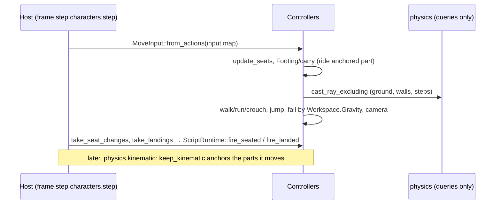

# Characters

> [!summary]
> `character` steps `ThirdPersonController` and `FirstPersonController` Instances (declared in `core`) with the same **kinematic** movement code: ray probes (`physics::cast_ray_excluding`), not a physics body. Walk, run and crouch are built-in modes; jump, slopes and step-up are movement on those modes; a custom `Movement` name hands motion to scripts. It also seats characters (Seats and VehicleSeats), rides anchored moving platforms, and provides the default character rig. Humanoids, Players and spawning live in `script` on top of it. **Implemented.**

## Architecture and flow

- The controller of a Player's `Character`, else the first controller in the Workspace with a body, receives input and owns the camera; others walk their `MoveDirection` (Humanoids).
- A seated character is unanchored and welded to its seat; `keep_kinematic` skips it.

## Dependencies

`core`, `anim` (seat `Sit` state), `assets`, `physics`. **`physics` must never depend on it**; `nav` may.

## Performance

**Measured** (S10k, 9950X3D): Characters was 2.70 ms with one player character (ray probes against 10,000 parts); after L4's kept query bounds the test runner's Characters step is 0.31 ms (cloud container). See [Optimization log](../Performance/Optimization-Log.md#l4-query-bounds).

## Testing

`crates/character/src/tests.rs`, `tests/seat.rs`; player tests `seat_tests.rs`, `vehicle_tests.rs`, `spawn_tests.rs`, `humanoid_tests.rs`, `default_humanoid_tests.rs` (the default humanoid asset).

## Development guidance

- Never change physics settings from here; fall by `physics::gravity(world)`.
- A new movement feature works in both controllers (only `Eye` and `pose_camera` differ).
- A character with a root part (its Model's `PrimaryPart`, else `HumanoidRootPart`) is measured by that part alone (`root_part`, `Body::rooted`): walls, ground, steps, crouch and feet use its box, every part still moves and turns with it, and a crouch squashes only it. That keeps a skinned mesh in an A-pose from widening the body.
- The default character is the skinned default humanoid (`project::default_character`, stage HD3 of `docs/research/default-humanoid.md`; smooth stylized since Character Studio CS1, [ADR-0030](../Architecture/Architecture-Decisions/ADR-0030-Smooth-Stylized-Humanoid-On-CC0-Base-Meshes-With-Mask-Shapes.md): its `Humanoid.glb` keeps the 41 face shapes and the clothing masks its outfit needs, resting at 1): an invisible `HumanoidRootPart` (the 0.30 m capsule's box, 0.86 × 5 studs) with the `Body` MeshPart welded to it, not colliding. Insert ▸ Character in a saved project and new projects from the character templates (StarterCharacter `assets/prefabs/Character.prefab.json`) use it; the six welded blocks (`rig.rs`) remain for unsaved projects and an empty StarterCharacter. Known gap: in first person the camera sits inside the head, whose eyeballs can show; hiding the head comes with modular parts (HD4).

## Related documentation

`docs/scripting/api-character.md`; [ADR-0007](../Architecture/Architecture-Decisions/ADR-0007-Fixed-Step-Physics-And-Kinematic-Characters.md); [Physics](Physics.md); [Animation](Animation.md)
