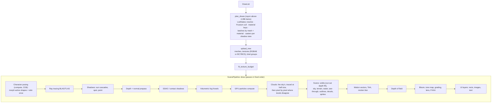

# Rendering

> [!summary]
> `render` draws a **`DrawList`** (items, materials, lights, sky, fog, decals, particles, UI, camera) with **wgpu 30** (M12, PR #104) and knows nothing about Instances ([ADR-0003](../Architecture/Architecture-Decisions/ADR-0003-Renderer-Consumes-Only-Draw-Data.md)). One private `ScenePipeline` serves both the player's `Renderer` (its own window surface) and the editor's `TextureRenderer` (a texture on eframe's device), so they draw identically. Forward PBR with a depth prepass, cascaded soft sun shadows, tiled point/spot/rect lights, LOD with cross-fades, frustum culling per view, GPU skinning, GPU particles, HDR post (bloom, tone mapping, grading, lens), TAA and motion blur. **Implemented.** No render graph ([ADR-0009](../Architecture/Architecture-Decisions/ADR-0009-No-Render-Graph-Yet.md)).

## Architecture

- **Conventions**: Y up, right-handed, sRGB colors 0–1 in the draw list (converted to linear), built-in shapes 1×1×1 at the origin (`transform = T × R × S(Size)`).
- **Materials**: base color, metalness, roughness, emissive, opacity, plus maps (normal, ORM channels, emission, opacity, specular), tiling, double-sided, shading model (Standard, Unlit, Toon, Skin, Hair, Cloth), outline, translucency (leaves), water, and an optional WGSL **surface shader** (`surface_shaders.rs`, checked by naga, pipelines cached by code hash). `render::Material` is additive (`..Default::default()`).
- **Particle curves** (R17.1): an emitter's size, color and transparency curves (`NumberSequence`/`ColorSequence`) reach the draw list as one 32-entry `ParticleCurves` table that the CPU sprites and `particles.wgsl` both sample, so the two paths can't drift apart. `None` keeps the start and end blend. R17.2 adds spawn shapes (`render::SpawnShape::point`, mirrored by `spawn_point` in `particles.wgsl` from the same three randoms) and a speed table in the same `ParticleCurves`; R17.2b adds bursts (counted in `scene`, so the GPU only sees births), inherited velocity (`ParticleEmitter::inherit`) and headings from the shape's middle (`SpawnShape::outward`, mirrored in `born`); R17.2c adds flipbooks (`Flipbook::frame`, mirrored by `flipbook_frame`; the frame rides in `SpriteRaw::params.zw`). R17.3's Effect tab plays an effect in a preview with its own `Particles` (see [Specialized editors](../Editor/Specialized-Editors.md)). See `docs/rendering/particles.md`.
- **GPU particle collisions** (R17.4b): a colliding emitter on the GPU lands its particles on this frame's depth and normal prepass (`collide` in `particles.wgsl`), which the renderer keeps alive while one is drawn. Screen-space: only what the camera sees stops them; small colliding emitters use physics rays on the CPU instead.
- **Lights**: tiled on the CPU (32 px tiles, up to 64 lights per tile, 1,024 total), not clustered.
- **Settings**: the machine's `GraphicsSettings` (Low/Medium/High/Ultra plus overrides) are a ceiling on the world's Lighting requests; capabilities lower what the GPU can't do with a note ([ADR-0013](../Architecture/Architecture-Decisions/ADR-0013-Look-Versus-Cost-Settings.md)). Frame targets exist only while used.
- **Characters** (2026-11-17, CO7's first slice): a character's skin tone values become a per-item base colour ratio in `scene` (render only sees a `Material`); under TAA the shadow filters' and contact shadows' per-pixel noise moves on each frame (`Frame::noise`, `shading_noise`), so a nearby limb's contact shadow no longer shows as hatching; surfaces with a normal map (and only those: `light_surface`'s `bumped`; leaves, water, decals, terrain and surface shaders without a normal map are unchanged) keep `bump_shadowing` of sun and lamp light (bump terminator), so grazing light no longer breaks into speckles as much. Without TAA (the High and Ultra presets' MSAA) the noise stays fixed, so still frames don't flicker, and the limb hatching still shows. GPU time unchanged for the realistic character at 1080p High with TAA (Scene pass 0.617 to 0.618 ms on an RX 9070 XT, `bench_realistic_character`). `docs/rendering/shadows.md`.
- **Compute posing** (2026-11-17, CO8 / refinement RA7, [ADR-0041](../Architecture/Architecture-Decisions/ADR-0041-Shared-Base-Mesh-With-Live-Identity-Morphs-Baking-Is-Optional.md) decision 2, `docs/rendering/animation.md`): before any pass, a compute pass morphs and skins each animated (skin, mesh) pair a view draws or ray tracing traces **once** into the frame's posed buffer (20 bytes a corner: position, octahedral normal and tangent), walking only the shapes whose weight isn't 0 (fixed-point atomic sums, so frames are deterministic). Every raster pass reads it through frame binding 9 (`pose_corner`), the motion pass reads last frame's copy, and ray tracing builds posed BLASes from it, so ray traced shadows, AO, reflections and GI see identity and expression shapes. Timed as `FramePass::CharacterPosing`; counted in `RenderStats::posing`.
- **Skin shading** (2026-11-17, R5, `skin.wgsl`, `docs/rendering/skin.md`): `Shading::Skin` for a material a model file marks `"axcenity_shading": "skin"` in its glTF `extras` (the human base's `Skin`). Diffuse light is lit by the normal map read blurred (pores never reach it) and spread across the terminator by a table pre-integrated from skin's diffusion profile by the surface's screen-space curvature, red furthest; shadow edges are redder; specular is two GGX lobes with specular antialiasing, so pores don't glitter under TAA or MSAA. A second, defined normal map (`axcenity_defined_normal`) takes the specular map's slot and is blended in by `SkinShading::normal_blend` (`scene`: `definition × (1 − softness)`; the realistic body, removed on 2026-11-25, was the one model with a defined map, and its manifest drove both from muscle and fat). Pores and fine lines finer than the maps are drawn by the model itself from the texture coordinates (`skin_micro`: a pit with a rim in half the cells of a 0.7 mm grid on the face, two sets of faint crossing lines; slope by screen-space derivatives, no tangents), fading out where a cell is under two pixels so they never alias. Every other material draws the pixels it drew before (a probe test). Cost, measured on the realistic character before it was removed, at 1080p High with TAA: about +0.03 ms in the Scene pass full-body and +0.06 ms face-filling (RX 9070 XT). Makeup and markings ([ADR-0042](../Architecture/Architecture-Decisions/ADR-0042-Makeup-And-Markings-Are-Layers-Over-Library-Masks-Drawn-Live-By-The-Skin-Model.md)): `SkinShading::layers`, three masks from the model file bound in the metalness, emissive and opacity places (no new binding: the item shader is at 16 sampled textures) with the layers' values in the surface parameters' place, drawn into albedo and roughness before light (`skin_layered`); none bound while no layer is on. Not yet: screen-space SSS (CO17), transmission, decals on characters.
- **Hair and Cloth shading** (2026-11-18, CO7 wave 4, `hair.wgsl`, `cloth.wgsl`, `docs/rendering/hair.md`, `cloth.md`): `Shading::Hair` and `Shading::Cloth` for materials a model file marks `"axcenity_shading": "hair"` or `"cloth"`. Hair is a Marschner-style model in Karis's approximation, lit along the strand (the card's tangent frame and an optional flow map): a white primary shifted toward the root, light through the fibre from behind, a wider secondary toward the tip tinted by the fibre's absorption, and Kajiya-Kay light among strands. Its colour is moved live along the eumelanin and pheomelanin absorption curve (melanin, redness, roots, tips, streaks over the card atlas's data map, dye); the atlas's data and flow maps take the metalness and specular places (no new binding). Cloth is Charlie sheen with Neubelt's visibility over Standard's light, dimmed by a pre-integrated sheen albedo table, with optional anisotropic GGX; read from glTF `KHR_materials_sheen` and `KHR_materials_anisotropy`. With neither, cloth draws as Standard. Alpha cards: a hair card's alpha is hashed under TAA (golden-ratio steps per frame over interleaved gradient noise, the band 0.2 to 0.8; frame-to-frame deviation 3.38 of 255 on a ramp card) and its coverage is its opacity under MSAA. **Hair cards cast through their holes in the shadow maps** (`fs_shadow_cut_out`: a second shadow pipeline with the caster's material), hashed against a fixed pattern so their shadows are many strands, not slabs; other cut-outs (foliage) still cast their whole cards, since through their holes the Shadows pass of 36,000 leaf cards rose from 0.19 to 0.42 ms (review fixes 1, `docs/rendering/shadows.md`); a hair shell (single-sided hair, or a layer lying on the head that its file marks `axcenity_hair_shell`) fades its light over the head's terminator, by the mesh's own normal, so a back-lit head shows no torn self-shadow band; ray traced shadows and AO already went through cut-outs on posed items (CO8's posed BLASes). OPEN-19 (a cut-out card on a skinned, morphed part showing the backdrop) doesn't reproduce since CO8 and is now pinned by a test. Every other material draws as before (the probe test).
- **Foliage under an overcast sky** (2026-11-26, `shader.wgsl`'s `lit_leaf` and `through_thin`, `docs/rendering/models.md`): leaves take the square root of screen-space ambient occlusion (`LEAF_SCREEN_OCCLUSION`; the prepass saw a crown as a heap of solid cards and, at the Overgrown Street showcase's strength 1.6, crowns went near black), the sky comes through a leaf from its far side in its crown tipped up a little (`LEAF_SKY_WRAP`; it had been the lifted side of low plants, so translucent grass let through the ground's dark), what comes through is capped at what the leaf doesn't reflect, and ground cover is darker at its foot (`LEAF_FOOT_SHADE_LOW`). Every other material draws as before. Tests `renderer/tests/foliage_light.rs`, four of which failed before.
- **Cut-outs keep their coverage far off under TAA** (2026-11-26, `shader.wgsl`, `docs/rendering/textures.md`): box-averaged mips turn a leaf atlas's alpha grey, so far foliage thinned to nothing under its cutoff or filled in solid over it. Under TAA, from 2.5 mip levels below full size to 4, a cut-out's threshold moves from its cutoff to a hashed one, so its averaged alpha is kept as coverage and TAA smooths it (depth fill, prepass, `fs_main`). Without TAA the cutoff stays: MSAA's alpha to coverage and a still hash both dithered the Overgrown Street showcase's far canopy visibly (RADV's fixed 2×2 alpha-to-coverage pattern). Tests `renderer/tests/cut_out_coverage.rs`.
- **Shadow views by mesh and kept lamp faces** (2026-11-26, `docs/rendering/shadows.md`, `docs/rendering/lights.md`): each shadow view sorts its casters by the material it draws them through and their mesh (`casters_in_views`), so a mesh is one instanced draw in a cascade, not one per camera distance band. A spot light's view and a point light's faces keep their layer while their still casters' fingerprint is the same (`renderer/lamp_shadows.rs`); casters that move every frame (posed, or swaying in wind) are drawn over a kept copy of the still ones (a second lamp map's memory, 100 MB at Ultra). A light's `ShadowStart` keeps what's nearer than it out of its shadows, maps and rays, for a lamp inside a fixture that's part of a larger mesh (Desert Homestead's porch lantern). Shadow maps keep the nearest depth whatever the order, so each draws the same pixels.
- **Screen-space reflections and wet ground** (2026-11-26, `renderer/screen_reflections.rs`, `screen_reflections.wgsl`, `docs/rendering/reflections.md`, `docs/rendering/weather.md`): at High and Ultra (`GraphicsSettings::screen_space_reflections`) a compute pass after the prepass marches a mirror ray from each solid pixel smoother than 0.45 across the screen through the prepass's depth and reads what it hits from **last frame's picture** (`FrameTargets::hdr`, which still holds it before the scene pass), reprojected with last frame's camera; a forward renderer has no lit picture of this frame before its surfaces are lit (HDRP reads last frame's color pyramid the same way). The result goes in frame binding 18, the ray traced reflections' buffer, which takes its place when drawn, so the item shader's 16 textures are untouched. While it's on, the sky's share of a reflection is shaded by sky visibility along it from the sun's shadow maps (`sky_open_along`), so wet ground under a canopy no longer mirrors the open sky. Wetness gathers first in a surface's cracks and low spots (the terrain layers' height and occlusion maps, a part's occlusion map, world noise; roughness 0.05 to 0.25 there), and snow's ragged edge no longer lies snow with no cover (the white blotches Overgrown Street's wet asphalt showed). Timed as `FramePass::ScreenReflections`.
- **Micro-shadowing** (2026-11-27, `lighting.wgsl`'s `micro_shadow`, `docs/rendering/shadows.md`): a surface's occlusion map also shades direct light, not only the sky's: `saturate(n·l / sqrt(1 − occlusion))²` (Chan 2018, Filament), so slanting sun goes dark in a part's or a mesh's cracks first, as a terrain layer's relief already shaded it (the terrain is left as it was). Light straight on is untouched; a surface with no occlusion map draws as before. Test `a_surfaces_occlusion_map_shades_slanting_sunlight_in_its_cracks`.
- **Glossy leaves** (2026-11-27, `docs/rendering/models.md`): a material's glTF `axcenity_glossy_leaf` lets `lit_leaf` light it at its own roughness instead of raising it to 0.72 to 0.9, and a hanging one stays a leaf rather than thin cloth. Overgrown Street's ivy uses it.
- **Half-resolution ray traced shadows** (2026-11-27, `GraphicsSettings::ray_traced_shadow_resolution`, `ray_shadows.wgsl`'s `cs_fill`, `docs/rendering/ray-tracing.md`): Full at Ultra, Half below unless chosen; at Half one pixel of each 2 × 2 block is traced (which one turns each frame) and a fill pass gives every pixel its nearest traced neighbours' result on its own plane and facing, before the soft shadows' smoothing.
- **A plant that casts no shadow** (2026-11-27, `docs/terrain.md`): a ScatterRule's `CastShadow` (and a Scatter pane item's Casts shadow) is carried on each `FoliageInstance` as `shadow`, which leaves the plant out of every shadow map and ray traced shadow; on by default.

## Source code

`crates/render/CLAUDE.md` names a file for every feature; the spine is:

| Where | What |
|---|---|
| `renderer.rs` | `Renderer`, `TextureRenderer`, `RenderStats` |
| `renderer/scene.rs` | `ScenePipeline`, `draw` (the frame), `schedule_cascades` |
| `renderer/types.rs` | GPU structs (`InstanceRaw`, `FrameUniform`, `MapsUniform`); must match `shader.wgsl` |
| `renderer/lighting.rs` | Uniforms, light tiles, shadow views, batches, `casters_in_views` |
| `renderer/posing.rs`, `posing.wgsl`, `renderer/skinning.rs` | Compute posing (CO8): every animated item morphed (active shapes only) and skinned once a frame into the posed buffer every pass and ray tracing read |
| `renderer/culling.rs`, `lod.rs`, `parallel.rs` | Frustum culling, LOD with hysteresis and dithered cross-fade, rayon sharing |
| `renderer/gpu.rs`, `uploads.rs`, `texture_budget.rs` | Uploads (CPU mips for RGBA), background uploads, budget |
| `renderer/occlusion.rs`, `post.rs`, `temporal.rs`, `lens.rs`, `grading.rs`, `sun_rays.rs` | Prepass and SSAO, post, TAA, depth of field, grading (brightness to palette, with split toning and an S-curve before the lookup table since 2026-11-26), screen-space sun rays (`SunRaysEffect`) |
| `renderer/gpu_timer.rs` | Per-pass GPU time (`FramePass`) |
| `renderer/cloud_trace.rs`, `cloud_trace.wgsl` | The sky's clouds traced before the scene pass (2026-11-26): their shapes from a texture round the camera, half size where sky shows, then each pixel, worked out afresh where the half-size texels disagree; the sky pass reads the result (`docs/rendering/clouds.md`) |
| `renderer/ray_ao.rs`, `ray_ao.wgsl` | Ray traced ambient occlusion (RT3): a half-size fragment pass blended into ambient occlusion's raw target before its blur |
| `renderer/ray_shadows.rs`, `ray_shadows.wgsl` | Ray traced sun shadows (RT1): a compute pass from the prepass into a per-pixel mask (frame binding 17) that `sun_visibility` prefers to the cascades within reach |
| `renderer/path_tracer.rs`, `path_tracer.wgsl` | The editor's Path Traced view: a reference picture, paths bounced through the ray traced scene and averaged while nothing changes |
| `renderer/clusters.rs` | What never changes about each group of items (`DrawList::chunks`), kept by the address of the group's shared items: material bindings, meshes, places, what rays find. `Draw::cluster` and `Draw::at` name a draw's group and item (`docs/rendering/performance.md`, "Plants by the cluster") |
| `renderer/encoders.rs` | `FrameEncoders`: the frame's commands recorded into several encoders (the shadow views with many casters, the prepass with the ray traced passes, the scene with what follows) and finished on the renderer's threads together, then submitted in order in one call. wgpu encodes a pass's draws in `finish`, so this is where 4.0 ms of the frame's thread went to 1.6 (`docs/rendering/performance.md`, "Encoding on several threads"); `AXCENITY_FRAME_ENCODERS=one` is the way back |
| `renderer/cpu_timer.rs`, `renderer/latency.rs` | The frame's thread timed in fifteen sections (`CpuSection`, `RenderStats::cpu_times`), and a frame's start to its finished picture, for benchmarks |
| `pacing.rs` | `FramePacer`: whether a host's next frame waits for the display to show the last one or starts while the GPU draws it; a renderer whose frames are shown is one frame ahead (`set_one_frame_ahead`, `ScenePipeline::wait_for_frame_before`) ([ADR-0052](../Architecture/Architecture-Decisions/ADR-0052-A-Frame-Starts-While-The-GPU-Draws-The-Last-When-Frames-Miss-The-Display.md)) |
| `renderer/ray_sway.rs`, `ray_sway.wgsl` | Swaying plants in the ray traced scene: bent into one buffer each frame and built as geometries of shared BLASes (`docs/rendering/ray-tracing.md`) |
| `renderer/ray_tracing.rs`, `ray_hits.wgsl` | Hardware ray tracing: BLAS per mesh, TLAS of nearby items, Ray Hits view ([ADR-0025](../Architecture/Architecture-Decisions/ADR-0025-Optional-Ray-Tracing-Through-Ray-Queries.md)) |
| `*.wgsl` (24 files) | `shader.wgsl` (items), `lighting.wgsl`, `sky.wgsl`, `terrain.wgsl`, `water.wgsl`, `post.wgsl`, … |
| `crates/render-types/src/graphics.rs` | `GraphicsSettings`, `Capabilities`, `EffectiveGraphics`, `Camera` (no GPU code) |

## Execution flow

1. The host builds a `DrawList` ([Scene bridge](Scene-Bridge.md)) in the frame's `draw.scene` / `draw.ui` steps (player) or in the viewport (editor).
2. `Renderer::render` / `TextureRenderer::render` → `ScenePipeline::draw`: plan (cull, LOD, batch, shadow casters), upload what's new, fit the texture budget, record passes, submit.
3. Resources not drawn for 600 frames and 10 seconds are freed; the player's window and the editor's viewport keep meshes and color textures while they fit their memory budgets instead ([ADR-0051](../Architecture/Architecture-Decisions/ADR-0051-A-Renderer-That-Shows-A-World-Keeps-Undrawn-Meshes-And-Textures-Within-Memory-Budgets.md)). GPU timings come back a frame or two later without the CPU waiting.

## Dependencies

`render-types`, `wgpu`, `glyphon` (text), `rayon`, `rustc-hash`, `bytemuck`, `glam`. Never `core`, Instances, scripts or winit.

## Performance

**Measured** highlights (details and machines in the [Optimization log](../Performance/Optimization-Log.md)):

| Work | Result |
|---|---|
| Frustum culling, LOD, foliage cull distance (graphics Phases 12–13) | Edge views stop drawing what's out of view; shadows were 43–52% of the GPU frame before |
| Threaded planning, per-thing work, cut-out depth fill, alternating far cascades (3f2fc05) | Painted forest at 1440p Ultra: CPU `ScenePipeline::draw` 39.6 → 9.5–10 ms; GPU 31 → 13.6–13.9 ms |
| Cooked BC7 textures (L2) | One 4096² map: first-frame upload 55–61 → 0.9–1.1 ms; GPU memory 85 → 21 MiB |
| Shadow views by mesh, lamp faces kept, `ShadowStart` (2026-11-26) | Desert Homestead at dusk, Ultra 1080p: draw calls 10,019 → 4,101, triangles 18.5 → 12.7 M, Shadows pass 4.80 → 4.02 ms, frame's thread 8.28 → 6.71 ms; the same pixels |
| Baseline (RX 9070 XT) | `bench_10000_parts` GPU frame 1.92 ms; 2,000 helmets 9.29 ms (154.5 M triangles before LOD) |

What's left (**Measured**, forest at Ultra): GPU-bound, 5.7 ms of shadow vertices and 7 ms of lighting at 3.7 M pixels; each shadow view copies 176-byte instances of which it reads 88 (slim shadow stream is part of L5).

## Measuring tools

Since rendering Phase 1 (PR #83): frame rate with 1% lows, CPU- or GPU-bound, per-pass and per-cascade GPU time, `OverdrawStats`, the LOD Inspector and `profile_project` (`docs/rendering/performance.md`, "Where the frame goes"). Planning runs on the renderer's own pool of at most 12 threads (PR #88).

## Configuration

`GraphicsSettings` (per machine: editor settings, player `graphics.json`; scripts via `UserGameSettings`): shadow quality and distance, post-processing, render scale (below 100% upscaled with an FSR 1-style EASU and RCAS pair, `upscale.wgsl`, or with TAA on by TAA itself at the output's size, then RCAS: G9 stage 2, `fs_taau`), texture quality and budget, anti-aliasing (Off, FXAA, MSAA 2×/4×, TAA), ambient occlusion, reflection quality, contact shadows, screen-space reflections, volumetric fog, real-time GI, decals, motion blur, the ray tracing distance, ray traced shadows, ambient occlusion and GI. `docs/rendering/settings.md` has the preset table.

## Testing

- `cargo nextest run -p axcenity-render` (277 tests; GPU tests in the `gpu` group, at most 8 at once).
- `axcenity-player`'s `every_example_renders` compares `crates/samples/projects/graphics` against `reference.png` per preset (fails at a mean drift of 6+ per channel).
- Benchmarks: `cargo test -p axcenity-player --release -- --ignored bench_ --nocapture --test-threads 1`; your own project with `AXCENITY_BENCH_PROJECT`.

## Limitations

- Overlapping see-through items can blend in the wrong order (sorted by center).
- AMD/Vulkan/Windows: sky clear not sRGB-encoded through an sRGB view (`docs/rendering/pipeline.md`).
- The item shader uses all 16 sampled textures and all 16 vertex attributes (wgpu defaults): a new frame texture must share or replace a binding; a new per-item value must pack into an existing attribute.
- Hardware ray tracing is an optional tier (RT0–RT5, `docs/research/hardware-ray-tracing.md`, `docs/rendering/ray-tracing.md`, [ADR-0025](../Architecture/Architecture-Decisions/ADR-0025-Optional-Ray-Tracing-Through-Ray-Queries.md)). RT0 (the device feature, the BLAS/TLAS scene, the ray tracing distance and the Ray Hits view) RT1 (ray traced sun shadows, falling back to the cascades for see-through surfaces and past the reach; rays pass through cut-outs' holes, `ray_cut_outs.rs`, while ambient occlusion and GI still trace cut-outs as solid) RT3 (ray traced ambient occlusion, over screen-space's) and RT2 (ray traced GI: light probes lit by rays in batches each frame, in Real-time GI's place: a 3-stud grid that follows the camera, so no volume is needed, plus any volumes; probes inside walls are left out; since 2026-11-14 coarser 12, 48 and 192-stud grids around it out to the ray tracing distance, each fading into the next, so GI no longer stops 24 studs away) are built, and since LE1 (the 2026-11-13 lighting audit) point, spot and rect lights with `Shadows` on cast ray traced shadows in the sun's pass (8 lamps a pixel, 4 bits each in the mask's second half). Since LE5 water at High and Ultra also traces reflection rays where its screen-space reflection finds nothing (`water_rays.wgsl`). Since LE3 the same pass traces the volumetric fog's air toward the sun (4 rays a cell within the reach, the mask's third part), so shafts in fog are ray traced too. The device is opened with ray queries only while Settings > Graphics > Hardware ray tracing is on (off by default, after a restart): opened with them, a white square flashed in the viewport on an RX 9070 XT. Bloom ignores pixels that aren't numbers and caps what one pixel adds (`post.wgsl`'s `finite_light`), so one broken pixel can't spread into a square. wgpu has no acceleration structure refit (every moved item rebuilds the TLAS), and skinned items aren't traced. Since 2026-11-14 swaying plants in a wind are bent on the GPU into BLASes of their own each frame (nearest first, 400k triangles a frame), so ray traced shadows move with the leaves. Settings > Graphics > **Use the ray traced look** (`GraphicsSettings::ray_traced`) turns it all on in one click, the viewport badge says whether it's drawing (with **Restart now**, which restarts the same editor with the session's handoff, when a restart is due), and the Learn guide `documentation/learn/ray-tracing.md` explains it; an old installed copy opened from a Desktop shortcut shares the settings but can't ray trace, so the badge stays on "restart to turn on".
- TAA's upscale (G9 stage 2) samples textures with no mip bias at lower render scales, so fine textures look as soft as the scene's size (`docs/rendering/temporal.md`).
- No GPU-driven drawing (L5, now unblocked by M12), no render graph (L8 deferred). Measured 2026-11-27 with `AXCENITY_OCCLUSION_PROBE`: occlusion culling in Overgrown Street would hide 14,000 to 33,000 of its 57,000 items in view yet save only 5 to 10% of the prepass and scene passes (37.2 → 39.2 fps without ray tracing). Built anyway on the owner's request (2026-11-28) for scattered items only (`renderer/occlusion_cull.rs`: the other solid batches' depth as a pyramid, a compute test, the kept compacted in order and drawn with indirect draws): it leaves out 2,000 to 16,000 plants and saves no more than it costs (`docs/rendering/performance.md`, "GPU occlusion culling of scattered items"), so it's off unless `AXCENITY_OCCLUSION_CULLING=1`. Frames acquire through `CurrentSurfaceTexture` (Lost or Outdated reconfigures, Timeout or Occluded skips the frame) since M12.

## Development guidance

- Keep `InstanceRaw`, `FrameUniform`, `MapsUniform`, vertex layouts and bindings in step with `shader.wgsl`; the shadow pipeline's instance layout gives offsets by hand.
- New feature: plain data in the `DrawList`, built by `scene`; defaults reproduce today's look; targets only while used; a setting with a capability check; tests that compare images. See [Add a render feature](../Guides/Recipes/Add-a-Render-Feature.md).
- Avoid wgpu features not on DX12, Vulkan and Metal.

## Related documentation

- `docs/rendering.md` (map to 20 topic files), `crates/render/CLAUDE.md`
- [Lighting and atmosphere](Lighting-and-Atmosphere.md), [Scene bridge](Scene-Bridge.md), [Animation](Animation.md) (GPU skinning), [Cooking](../Asset-Pipeline/Cooking.md)
